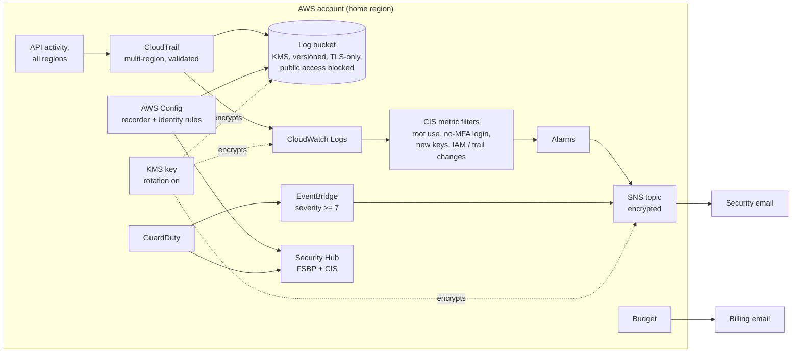

# AWS account lockdown: guardrail baseline + before/after Prowler report

[](https://github.com/YounessAbbida/aws-account-lockdown/actions/workflows/ci.yml)

> **Reference implementation — not deployed.** This repository is published as
> code and documentation only. It has not been applied to an AWS account, and
> nothing here claims a live run or real scan results. The report in `docs/`
> is a **template** with placeholders, not a client report. CI checks the code
> on every push (`terraform fmt`/`validate`, tflint, Checkov, shellcheck, unit
> tests) without any AWS credentials.

A Terraform baseline that turns on the AWS guardrails most small accounts are
missing, plus the process to prove it worked: a Prowler scan before, the fixes,
a Prowler scan after, and a report comparing the two.

## Problem

Startups and small teams often run production in an AWS account that nobody
has hardened: root without MFA, old access keys on IAM users, no audit trail,
no threat detection, buckets that can be made public, and no alert when the
bill spikes. A security scanner shows hundreds of findings, but a list of
findings is not a fix.

## Result

- **Fixed, not just reported.** Each guardrail is Terraform, so it is reviewed,
  repeatable and stays in place.
- **Measured.** A Prowler baseline and re-scan, compared by a script, give a
  before/after table by severity that a non-specialist can read.
- **Watched.** Root use, console logins without MFA, new access keys, IAM
  policy changes, CloudTrail changes and high-severity GuardDuty findings are
  emailed.

## What the baseline turns on

| Guardrail | How | File |
|---|---|---|
| Root MFA check | AWS Config `ROOT_ACCOUNT_MFA_ENABLED` + manual steps in [docs/root-account.md](docs/root-account.md) | `detection.tf` |
| Root access-key check | AWS Config `IAM_ROOT_ACCESS_KEY_CHECK` | `detection.tf` |
| Access-key audit | Config rules for key age (90 days) and unused credentials (45 days), console MFA; [`scripts/access-key-audit.sh`](scripts/access-key-audit.sh) for a per-user, per-key table | `detection.tf` |
| S3 public access block | Account-level, all four settings | `account_baseline.tf` |
| CloudTrail | Multi-region, global events, log file validation, KMS, S3 + CloudWatch Logs, 365-day retention | `cloudtrail.tf`, `log_bucket.tf` |
| GuardDuty | Detector with S3 data events, findings every 15 minutes | `detection.tf` |
| Security Hub | AWS Foundational Security Best Practices + CIS AWS Foundations Benchmark v3.0.0, consolidated controls | `detection.tf` |
| AWS Config | Records all resources, needed by Security Hub controls | `detection.tf` |
| Security alerts | CIS metric filters and alarms on CloudTrail; GuardDuty severity >= 7; encrypted SNS topic | `alerts.tf` |
| Budget alerts | 50% and 80% actual, 100% forecasted | `budget.tf` |
| Extras at no cost | EBS encryption by default, CIS password policy, IAM Access Analyzer (external access) | `account_baseline.tf` |

## IAM clean-up

Identity is where most small-account findings are, so it has its own track:

| Piece | What it gives | Where |
|---|---|---|
| Credential report audit | Every user: MFA, password use, each key's age and last use, with findings (root keys, no MFA, old or unused keys) | [`scripts/access-key-audit.sh`](scripts/access-key-audit.sh) |
| IAM Access Analyzer, unused access | Roles, users, keys and permissions unused for 90 days (configurable) | `terraform/iam.tf` |
| MFA enforcement policy | Group `<project>-mfa-required`: members can only set up their own MFA until they sign in with it | `terraform/iam.tf` |
| Before/after IAM report | **Template** to record what was removed and why | [docs/iam-report-template.md](docs/iam-report-template.md) |

## Maps to SOC 2 areas

Which technical controls in this repository support which SOC 2 Common
Criteria areas. This is a mapping of AWS configuration only: it is not an
audit, does not make an account SOC 2 compliant, and covers no policies,
procedures or evidence collection.

| SOC 2 area | Technical controls here |
|---|---|
| CC6.1 logical access | Root MFA and root-key checks, MFA enforcement policy, CIS password policy, S3 account public access block, KMS encryption of logs |
| CC6.2 / CC6.3 provisioning and removal of access | Access-key audit, unused-credential and key-rotation Config rules, IAM Access Analyzer unused access, IAM report template |
| CC6.6 access from outside the boundary | IAM Access Analyzer external access, S3 public access block, Security Hub controls |
| CC7.2 monitoring for anomalies | CloudTrail (multi-region, validated), GuardDuty, CIS metric-filter alarms, Security Hub, AWS Config |
| CC7.3 evaluating security events | Alerts routed to an owned email via encrypted SNS; GuardDuty severity threshold |

## Architecture



## Process

1. **Baseline scan** with Prowler and the access-key audit ([docs/prowler.md](docs/prowler.md)).
2. **Root account** steps by hand ([docs/root-account.md](docs/root-account.md)).
3. **Apply** the Terraform baseline, add human users to the MFA group, and clean up IAM users, keys and unused access ([docs/RUNBOOK.md](docs/RUNBOOK.md)).
4. **Re-scan** after 24 hours and compare with [`scripts/prowler_compare.py`](scripts/prowler_compare.py).
5. **Report** using the [before/after template](docs/report-template.md) and the [IAM report template](docs/iam-report-template.md).

Real scan output names resources and account IDs, so `prowler-output/` is
gitignored and filled-in reports stay with the client.

## Security decisions

| Decision | Why |
|---|---|
| One customer managed KMS key with rotation for trail, logs, Config and alerts | Log readers need `kms:Decrypt` as well as S3 access; key policy scopes each service with `aws:SourceArn` / `aws:SourceAccount` |
| CloudTrail log file validation | Tampering with delivered logs is detectable |
| Log bucket: `BucketOwnerEnforced`, versioning, TLS-only, Glacier IR after 90 days | Private, recoverable, cheap to keep for a year |
| Service write access limited to `cloudtrail/AWSLogs/<account>/` and `config/AWSLogs/<account>/Config/` | Each service can only write its own prefix |
| Metric filters instead of per-event SNS on the trail | Alerts on what matters (CIS monitoring controls), not on every log file |
| No forced password expiry | NIST SP 800-63B; MFA and unused-credential checks cover the risk |
| Prowler runs with `SecurityAudit` + `ViewOnlyAccess` | The scan cannot change anything |

Checkov exceptions are commented inline next to each resource with the reason.

### What a production setup adds

AWS Organizations with a delegated security account, an organization trail,
GuardDuty, Security Hub and Config enabled in every region and member account,
SCPs (deny leaving the organization, deny disabling CloudTrail/GuardDuty, region
restrictions), S3 Object Lock on the log bucket, cross-region log replication,
and IAM Identity Center instead of IAM users.

## Repository layout

```
terraform/
  account_baseline.tf   S3 account public access block, EBS default encryption, password policy, Access Analyzer
  iam.tf                unused-access analyzer, MFA enforcement policy and group
  cloudtrail.tf         multi-region trail, CloudWatch log group and delivery role
  log_bucket.tf         log bucket and its policy
  kms.tf                security key and key policy
  detection.tf          GuardDuty, Security Hub, AWS Config and identity rules
  alerts.tf             SNS topic, CIS metric filters and alarms, GuardDuty rule
  budget.tf             monthly budget alerts
scripts/
  access-key-audit.sh   credential report -> per-user MFA and key table with findings
  prowler_compare.py    before/after Prowler CSV -> Markdown tables
docs/
  RUNBOOK.md            end-to-end order of operations
  prowler.md            Prowler install, scan, re-scan, compare
  root-account.md       manual root hardening
  report-template.md    TEMPLATE for the client report
  iam-report-template.md TEMPLATE for the IAM before/after report
tests/                  unit tests on synthetic fixtures
```

## Cost

Estimated at **$5 to $20 per month for a small account** if applied, mostly
AWS Config, Security Hub and GuardDuty, which scale with the number of
resources and events. GuardDuty and Security Hub include a 30-day free trial
that shows the real projected cost in their consoles. The first CloudTrail
management trail is free; the KMS key is $1 per month. The IAM Access
Analyzer unused-access analyzer is billed per IAM role and user analyzed each
month; check current pricing for your number of identities.

## License

MIT, see [LICENSE](LICENSE).
